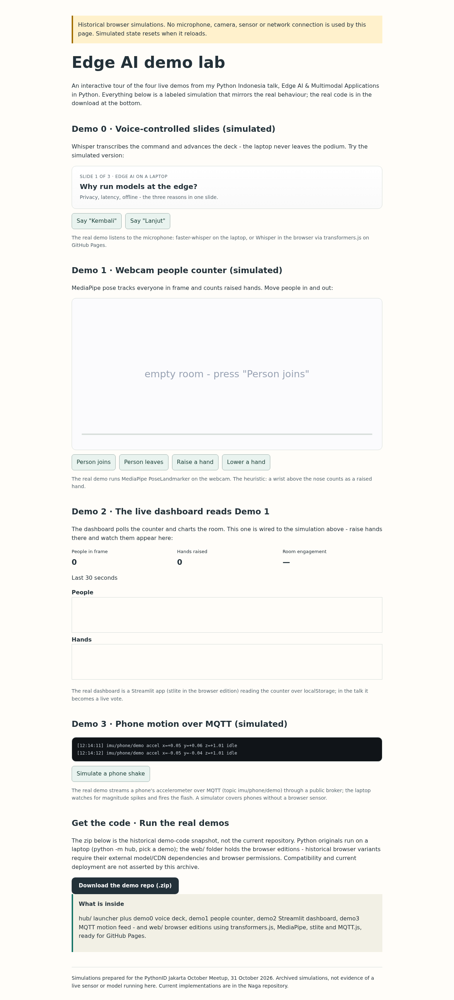

# Historical four-demo simulation lab

Open index.html locally in a modern browser. The checked-in bundle runs without installation. Source and pinned build dependencies are included; npm install then npm run build rebuilds it.

Retains all four original simulation controls: slide command buttons, people/hand counter and SVG figures, a linked 30-second dashboard, and random sensor log with shake/flash simulation. This page requests no microphone, camera, sensor or network access. Presentation-only wrappers were made portable, the sample phone topic is generic, and simulated flash/broker wording is explicit. The historical downloadable demo-code ZIP is preserved separately; it is not the current Naga repository and its external dependencies are not guaranteed.

React and ReactDOM licenses are in THIRD_PARTY_LICENSES.txt.

## Preview

[Mobile preview](preview-390.png). These previews show the simulation, not real device execution.
